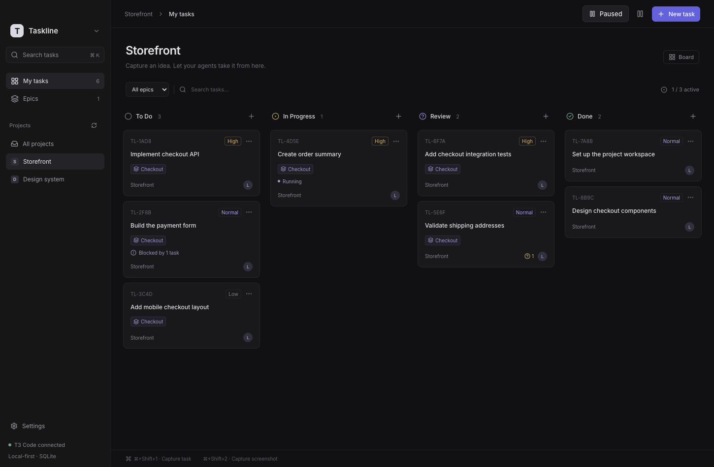

<div align="center">
  
  <h1>Taskline</h1>
  <p><strong>Capture anywhere. Queue the work. Review the result.</strong></p>
  <p>A local-first Kanban and global capture companion for <a href="https://github.com/pingdotgg/t3code">T3 Code</a>.</p>

[](https://github.com/qisoft/taskline/actions/workflows/build.yml)
[](https://github.com/qisoft/taskline/releases/latest)
[](LICENSE)

[Download](https://github.com/qisoft/taskline/releases/latest) · [CLI](#cli) · [Development](#development) · [Report a bug](https://github.com/qisoft/taskline/issues/new)

</div>

Taskline turns prompts and screenshots into a backlog that your coding agents can execute. Capture an idea without switching to T3 Code, choose a project and thread, and let the queue do the scheduling. Come back to the board for results, screenshots, tests and questions that need your attention.

Your tasks, attachments and execution history live in a local SQLite database. T3 Code owns agent execution and Git workspaces. Taskline connects through T3's authenticated API; it never edits T3's database.



_Demo board using sample data._

## What you can do

- **Capture from any app.** A global shortcut opens a prompt; another lets you select a screen region on any connected monitor and attach it to a task. Use your OS dictation or existing voice typing tool.
- **Plan before you run.** Pause a project, build its backlog in the app or CLI, then activate it. Configure a parallel-task limit for each project.
- **Choose where work happens.** Target an existing T3 thread, a separate new worktree, or an explicitly shared future thread with `--thread-key`.
- **Order the work.** Set priorities and dependencies. Blocked tasks wait until every prerequisite reaches Review or Done; ready tasks run by priority.
- **Keep shared context in epics.** Group tasks with common requirements, acceptance criteria and decisions. Each attempt freezes the context it received.
- **Review evidence.** Read the agent's result, test evidence, remaining work and questions. Open input/result images inside Taskline, answer approval/input requests, accept work or request a revision.
- **Keep execution safe.** Tasks sharing a thread run sequentially. Separate threads use separate worktrees, with project limits and shared-workspace protection.

The lifecycle is **To Do → In Progress → Review → Done**. Agent completion moves a card to Review; accepting its result moves it to Done. Summaries do not override authoritative task state.

## Install

Download an artifact from [GitHub Releases](https://github.com/qisoft/taskline/releases/latest):

| Platform             | Download                             | Install                          |
| -------------------- | ------------------------------------ | -------------------------------- |
| macOS, Apple Silicon | `Taskline-<version>-macos-arm64.dmg` | Drag Taskline into Applications. |
| macOS, Intel         | `Taskline-<version>-macos-x64.dmg`   | Drag Taskline into Applications. |
| Windows x64          | `Taskline-<version>-windows-x64.exe` | Run the per-user installer.      |

ZIP archives are also provided for both platforms. Releases currently use local ad-hoc signing on macOS and are not notarized; Windows builds are not Authenticode-signed. Your OS may show an unidentified-publisher warning. Only install artifacts from this repository. Taskline does not yet update itself; download a newer release to upgrade.

### Connect to T3 Code

1. Install and start [T3 Code](https://github.com/pingdotgg/t3code).
2. Open Taskline and choose **Connect local T3** in Settings. Taskline uses T3's installed CLI to issue a scoped session.
3. Choose a project, set its execution policy and create a task.

For another environment, enter its server address and scoped token in Settings. Use a Git repository with an initial commit for tasks that create worktrees. Tasks run with your configured T3 provider and credentials; Taskline does not supply an AI subscription.

### Global shortcuts

| Action                  | macOS      | Windows        |
| ----------------------- | ---------- | -------------- |
| Open the board          | `⌘ ⇧ 0`    | `Ctrl Shift 0` |
| Capture a task          | `⌘ ⇧ 1`    | `Ctrl Shift 1` |
| Capture a screen region | `⌘ ⇧ 2`    | `Ctrl Shift 2` |
| Submit a task           | `⌘ Return` | `Ctrl Enter`   |

Change the global shortcuts in Settings if another app uses them. Closing the board hides it; the menu-bar/system-tray icon keeps Taskline available. Quit the application to stop its scheduler. Turns already submitted to T3 continue and are reconciled when Taskline reopens.

On macOS, enable **Taskline** in **System Settings → Privacy & Security → Screen Recording** for screenshots. Settings also offers **Always show Taskline in the Dock**. These controls are macOS-specific. Dictation is supplied by your OS or existing tool, not a separate Taskline transcription service.

## CLI

Taskline installs the `taskline` command automatically on its first launch and keeps it pointed at the current application. It uses the app's bundled runtime, so a separate Node.js installation is not required.

Open a new terminal after the first launch, then run:

```sh
taskline --help
```

The desktop app must be running to manage the board. On macOS and Linux, Taskline installs into `~/.local/bin` and adds it to your shell startup configuration. On Windows, it installs a per-user command and adds its directory to your user `PATH`. No administrator access is required. Existing unrelated commands are never overwritten; installation errors appear in Settings.

Add `--json` to commands for structured output.

### Plan a backlog

```sh
taskline project pause website
taskline epic add --project website --name "Checkout" --context-file plan.md
taskline task add --project website --epic Checkout --thread-key checkout-api --priority high --prompt "Implement the API"
taskline task add --project website --epic Checkout --thread-key checkout-api --prompt-file api-tests.md
taskline task add --project website --epic Checkout --thread-key checkout-ui --prompt "Implement the UI"
taskline task list --project website --json
taskline project activate website
```

New CLI-created projects default to **Paused**:

```sh
taskline project create --name "My project" --path /absolute/path/to/repo --paused
taskline project set "My project" --limit 3 --base main
taskline project activate "My project"
```

Pausing a project prevents new starts and lets existing turns finish. A global pause holds all projects. Without `--project`, the CLI resolves the project from the current Git workspace, including worktrees. Projects/epics accept unique names or IDs; tasks accept full IDs or unique `TL-ABCD` codes.

### Threads, priorities and blockers

`--thread new` gives a task its own conversation/worktree. Use `taskline thread list` and `--thread ID` for an existing thread. Tasks using the same **project-scoped** `--thread-key` share one durable future thread: the first admitted task creates it and later tasks reuse it sequentially. This binding belongs to tasks, independently of epic membership. Missing or archived materialized threads are not silently recreated.

```sh
taskline task add --priority high --blocked-by TL-ABCD --prompt "Implement the dependent part"
taskline task update TL-EF12 --priority urgent
taskline task block TL-EF12 --by TL-3456
taskline task unblock TL-EF12 --by TL-ABCD
taskline task update TL-EF12 --clear-blockers
taskline task list --blocked --json
```

Priorities are `urgent`, `high`, `normal` (default), `low` and `none`. All blockers must reach **Review or Done**. Failed, cancelled, paused and missing blockers keep dependents waiting. Dependencies can span projects, but cannot form cycles. `--blocked-by` on `add`/`update` replaces the complete list; repeat it for several blockers. `block`/`unblock` edit individual links. Dependencies control admission, not branch merging; use a shared thread when work should continue in the same checkout.

Use `--image file.png` for attachments and `--prompt-file -` for stdin. Task commands also include `show`, `pause`, `resume`, `cancel`, `accept`, `retry`, `revise`, `answer`, `approve`, `report` and `delete`. Run `taskline --help` for the full reference.

## Results and local data

Agent results, questions and observed evidence remain available even if report generation fails. Optional task reports and epic summaries use a locally authenticated **Codex CLI**, with `gpt-6-luna` as the default summarization model. Configure another available model with `TASKLINE_REPORT_MODEL`; use `TASKLINE_CODEX_PATH` for a custom executable. Summaries do not consume a T3 execution slot.

Default data directories:

- macOS: `~/Library/Application Support/Taskline/`
- Windows: `%APPDATA%\Taskline\`

The directory contains `taskline.sqlite`, screenshot blobs, report artifacts and `connection.json`. The connection file contains your scoped T3 token: do not share it or include it in bug reports. Back up the complete directory while Taskline is quit. Prompts are sent to the provider configured in T3; report inputs go to your local Codex CLI/provider. Local storage does not mean offline model execution.

Taskline binds its API to `127.0.0.1:4318`. `TASKLINE_URL` or `--url` chooses another API address for the CLI. Desktop/server overrides include `TASKLINE_DATA_DIR`, `TASKLINE_PORT`, `TASKLINE_T3_HOME`, `TASKLINE_T3_PATH` and `TASKLINE_CODEX_PATH`. `TASKLINE_APP_PATH` overrides the executable launched by `taskline start`.

## Development

Requirements: Node.js 24+, npm, Git, and a native macOS or Windows machine for packaging that platform.

```sh
git clone https://github.com/qisoft/taskline.git
cd taskline
npm ci
npm run check:sources
npm run lint
npm run format:check
npm run typecheck
npm test
npm run build
npm start
```

`npm run build` compiles the TypeScript server, Electron shell and standalone CLI into `build/`, and Vite builds the React interface into `dist/`. `npm run typecheck` checks all application/tooling sources with strict TypeScript settings. Installed packages run compiled JavaScript and need no TypeScript runtime.

`npm run server` plus `npm run dev` starts the API and Vite separately. Launch the desktop shell with `TASKLINE_UI_ORIGIN=http://127.0.0.1:4317 npm start` for hot reload (set the environment variable using your shell's syntax).

```sh
# macOS: signed ad-hoc app, DMG and ZIP
npm run dist:mac -- --arm64
npm run dist:mac -- --x64
# Windows: NSIS installer and ZIP
npm run dist:win -- --x64
```

`npm run package` retains the local macOS unpacked-app workflow. CI builds native distributions for Apple Silicon, Intel macOS and Windows x64, runs offline unit/API tests and a packaged-app smoke test, and uploads artifacts on pushes and pull requests. These checks launch no real coding-agent tasks.

### Release

Update `version` in `package.json` and `package-lock.json`, commit, then push a matching tag:

```sh
npm version patch
git push origin main --follow-tags
```

A `v*` tag must match the package version. Once every platform build and packaged smoke test passes, the workflow publishes a GitHub Release with installers, archives, standalone CLI scripts and `SHA256SUMS.txt`. Tags with a prerelease suffix publish as prereleases. Publishing uses the workflow's `GITHUB_TOKEN`; no personal access token is required. App signing/notarization certificates are not configured in this repository.

See [CONTRIBUTING.md](CONTRIBUTING.md) for test boundaries and contribution guidance. T3's protocol can change; the integration is isolated in `server/t3.ts`. Taskline is an independent project, not an official T3 Code product.

## License

[MIT](LICENSE) © qisoft. Electron and bundled dependencies retain their respective licenses.
